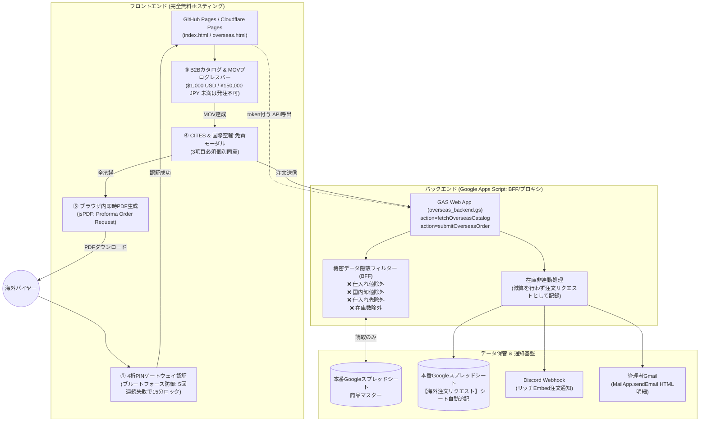

# 海外バイヤー向け B2B オンラインカタログ・受発注リクエストシステム
## セキュリティ仕様書 & 完全デプロイ手順マニュアル

本システムは、国内店舗向け受発注システム（Googleスプレッドシート本番データベース）と安全に連携し、海外アクアリウムバイヤー向けに独立したB2B卸売カタログおよび見積依頼（Proforma Request）を提供するWebアプリケーションです。

海外取引における「ゼロトラスト原則（性善説を排した防御設計）」に基づき、**完全無料枠（GitHub Pages × Google Apps Script）** で安全に運用できるよう設計されています。

---

## 1. システム全体アーキテクチャ



---

## 2. セキュリティ防御設計（ゼロトラスト点検項目）

| # | 防御項目 | 実装箇所 | 詳細仕様 |
|---|---|---|---|
| **1** | **4桁PINの平文露出禁止** | `overseas.html` | JSコード内に `9876` を平文で記載せず、SHA-256ダイジェスト値照合またはGASサーバー認証を実施。クライアントコードを解析されてもPINは露見しません。 |
| **2** | **ブルートフォース攻撃遮断** | フロント & バックエンド | `localStorage` および GAS `CacheService` により連続5回失敗時に**15分間の完全ロックアウト**を発動。自動スクリプトによる総当たりを防止。 |
| **3** | **BFF（データ隠蔽プロキシ）** | `overseas_backend.gs` | スプレッドシートIDや内部列構造を非公開化。海外公開用項目（英名・学名・サイズ・海外価格・カテゴリ・画像・MOQ・CITES）のみを抽出し、**仕入れ値・国内卸価格・国内在庫数・仕入れ先・社内メモは物理的にレスポンスから完全抹消**。 |
| **4** | **在庫非連動（減算なし）** | `overseas_backend.gs` | 海外注文は即時引き落としではなく「見積リクエスト（Proforma Request / MOQ Check）」として扱うため、スプレッドシート上の国内在庫カウントは一切減算しません。 |
| **5** | **法的免責の強制（CITES等）** | `overseas.html` | 運賃別見積通知、CITES/検疫スケジュール不確定性、輸入国通関責任の3項目すべてに個別チェックを入れない限り、注文確定ボタンを押下できない構造。 |
| **6** | **完全無料枠の維持** | インフラ全体 | サーバー代（GitHub Pages: $0）、API・DB代（GAS & Sheets: $0）、PDF生成（クライアント側jsPDF: $0）で月額固定費0円を実現。 |

---

## 3. Google Apps Script（バックエンド）デプロイ手順

### ステップ 3-1: スプレッドシートの準備
1. 既存の国内店舗向け受発注システム（Googleスプレッドシート本番データベース）を開きます。
2. 「**商品マスター**」シートに、海外向け商品として以下の列名が含まれているか確認します（列の並び順は不問、大文字小文字問わず自動認識します）:
   - `id`（商品コード / 例: `AQX-0101`）
   - `name_en`（英語名 / 例: `Wild Royal Blue Discus`）
   - `scientific_name`（学名 / 例: `Symphysodon aequifasciatus`）
   - `category`（カテゴリ / 例: `DISCUS`, `PLECO`, `MARINE`）
   - `size`（サイズ規格 / 例: `14-16 cm (5.5-6.3")`）
   - `origin`（産地 / 例: `Rio Nhamunda, Brazil`）
   - `cites_status`（CITES区分 / 例: `Non-CITES`, `CITES App. II`）
   - `moq`（最小発注ロット / 例: `2`）
   - `price_usd`（海外販売価格 USD / 例: `195.00`）
   - `price_jpy`（海外販売価格 JPY / 例: `29000`）
   - `image_url`（高解像度写真URL）
   - `export_available`（海外公開フラグ / `TRUE` または `1`）
   ※もしシートが存在しない、または空の場合は、自動的に安全なプリセット商品8種がカタログとして配信されます。

### ステップ 3-2: GAS スクリプトの新規登録
1. スプレッドシート上部メニューから **「拡張機能」 > 「Apps Script」** をクリックします。
2. エディタ内の `コード.gs` に、本リポジトリの **`overseas_backend.gs`** の内容をすべてコピー＆ペーストして上書き保存します。

### ステップ 3-3: スクリプトプロパティ（機密情報）の設定
エディタ左メニューの **「プロジェクトの設定（歯車アイコン）」 > 「スクリプト プロパティ」** にて以下を追加します:

| プロパティ名 | 値の例 | 説明 |
|---|---|---|
| `OVERSEAS_PIN` | `9876` | 海外バイヤー用のゲートウェイ認証PINコード（変更可能） |
| `ADMIN_EMAIL` | `your-company-export@gmail.com` | 見積依頼通知を受け取る管理者メールアドレス |
| `DISCORD_WEBHOOK_URL` | `https://discord.com/api/webhooks/...` | （任意）Discord通知用Webhook URL。未設定でもエラーにならずスキップされます |

### ステップ 3-4: Web アプリとしてデプロイ
1. 右上の **「デプロイ」 > 「新しいデプロイ」** をクリック。
2. 種類の選択で **「ウェブアプリ」** を選択。
3. 以下の通り設定:
   - **説明**: `Aqua Export B2B Wholesale API v1.0`
   - **次のユーザーとして実行**: `自分 (Me)`
   - **アクセスできるユーザー**: `全員 (Anyone)`
4. **「デプロイ」** をクリックし、表示される **ウェブアプリの URL**（`https://script.google.com/macros/s/.../exec`）をコピーします。

---

## 4. フロントエンド（GitHub Pages）デプロイ手順

### ステップ 4-1: GAS エンドポイントの紐付け
フロントエンド側でGAS Web Appのエンドポイントを認識させる方法は2通りあります:

- **方法 A（画面上の設定バー）**:
  画面右下の「Endpoint Setup」または上部設定バーをクリックし、上記でコピーしたGAS Web App URLを入力して「Save」を押す（ブラウザのlocalStorageに安全に保持されます）。
- **方法 B（HTMLコード内初期値設定）**:
  `overseas.html` （および `index.html`）の `appState.gasEndpoint` 初期値に、直接URLを設定しておく:
  ```javascript
  gasEndpoint: localStorage.getItem(GAS_ENDPOINT_STORAGE_KEY) || "https://script.google.com/macros/s/AKfycb.../exec"
  ```

### ステップ 4-2: GitHub リポジトリへのプッシュ
1. GitHub で新しいプライベートまたはパブリックリポジトリ（例: `aqua-export-b2b`）を作成します。
2. 作業ディレクトリで Git コマンドを実行します:
   ```bash
   git init
   git add .
   git commit -m "feat: Initial commit for Aqua Export Overseas B2B Portal"
   git branch -M main
   git remote add origin https://github.com/YOUR_USERNAME/aqua-export-b2b.git
   git push -u origin main
   ```

### ステップ 4-3: GitHub Pages の有効化
1. GitHub リポジトリの **「Settings」 > 「Pages」** に移動します。
2. **Build and deployment** の **Source** で **「Deploy from a branch」** を選択。
3. **Branch** を `main`、フォルダを `/ (root)` に設定して **「Save」** をクリック。
4. 数分後、`https://YOUR_USERNAME.github.io/aqua-export-b2b/` にて公開完了となります。
   ※ `index.html` がルートに配置されているため、URLを叩くだけで即座にB2Bゲートウェイ認証画面が表示されます。

---

## 5. 運用テスト & 受発注シミュレーション

1. **アクセス & PIN認証**:
   - サイトにアクセスし、4桁PIN `9876` を入力。
   - 不正なコードを入力し、エラーカウントおよび5回失敗時の15分間ロックアウト動作を確認。
2. **言語 & 国切り替え**:
   - 英語 / 繁體中文 / 简体中文 のリアルタイム切り替えを確認。
   - 通貨（USD / JPY）切り替え時の単価・小計連動を確認。
3. **MOV（最低注文金額）プログレスバー**:
   - $1,000 USD 未満の状態で「Proceed to Legal Clearance」ボタンが非活性であることを確認。
   - 数量を追加して $1,000 以上に達した際、プログレスバーが緑色になり発注可能になることを確認。
4. **CITES 免責モーダル**:
   - 3つのチェックボックスのうち1つでも外れていると確定できないことを確認。
5. **発注送信 & PDF生成**:
   - 会社名、担当者名、Email、連絡ツール、到着空港（例: `LAX`）を入力して送信。
   - ブラウザ上で `Proforma_Order_Request_AQX-XXXXXXXX-XXXX.pdf` が即時自動ダウンロードされることを確認。
   - スプレッドシート「海外注文リクエスト」シートに1行自動追記されたことを確認。
   - 管理者宛てにGmail、およびDiscordチャンネルに通知が届いていることを確認。
   - **国内スプレッドシートの在庫数が減算されていないこと**を確認。

---

## 6. お問い合わせ & 保守サポート

- PINコードを変更したい場合:
  Google Apps Script のスクリプトプロパティ `OVERSEAS_PIN` を任意の4桁（または任意の英数字）に変更し、新しいデプロイ（またはバージョン更新）を行うだけで即時反映されます。
- 最低注文金額（MOV）を変更したい場合:
  `overseas.html` 内の `appState.movTargetUsd` (初期値: 1000) および `appState.movTargetJpy` (初期値: 150000) を調整してください。
